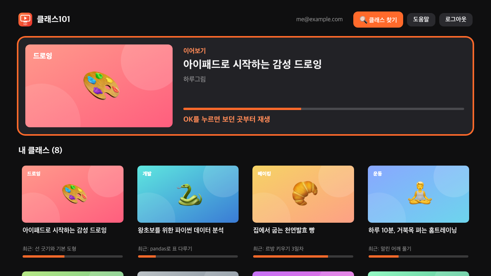
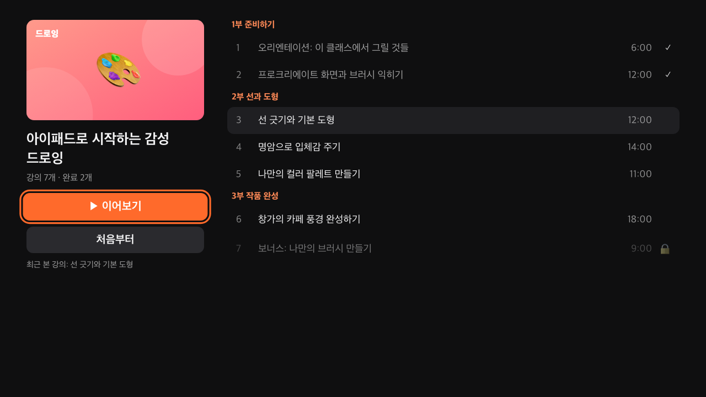
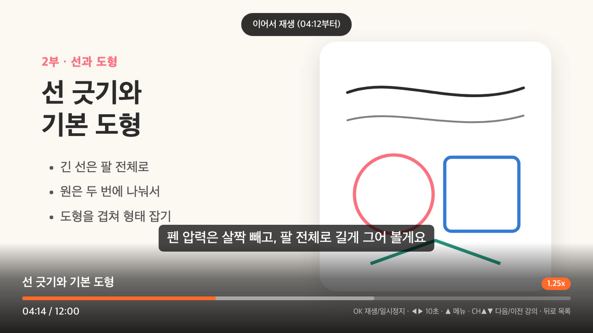
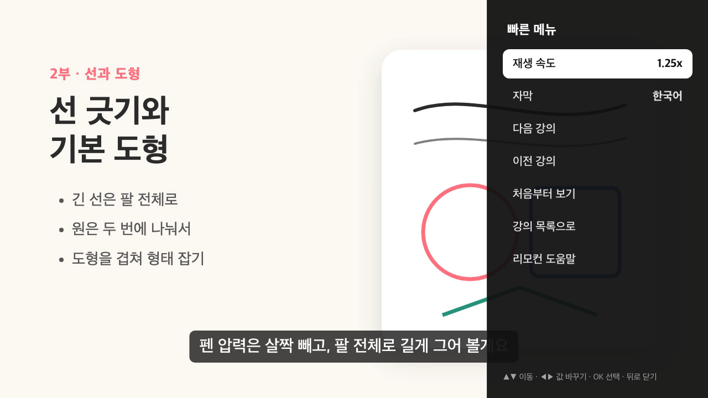
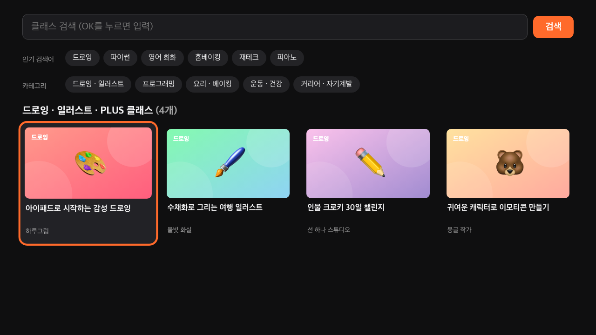
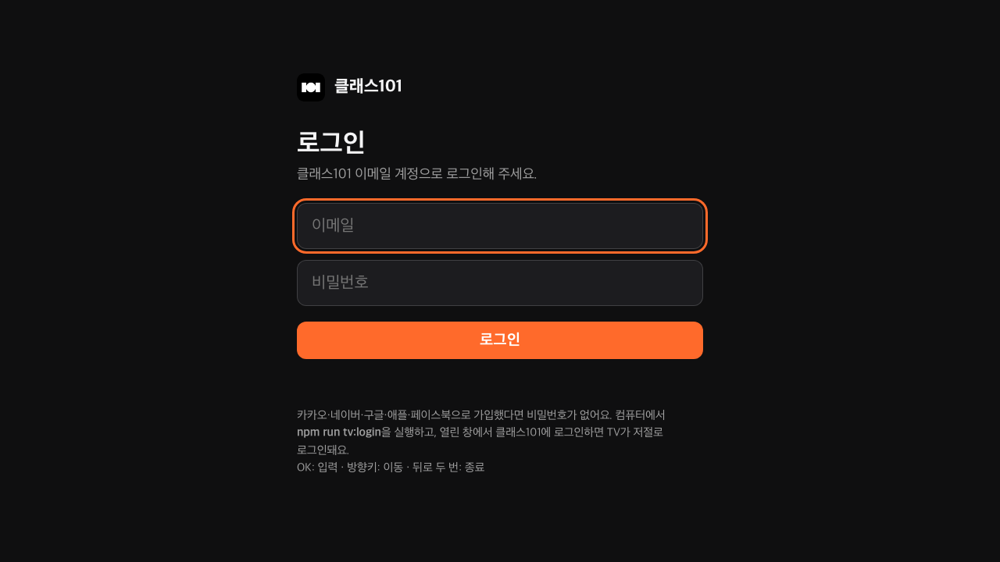
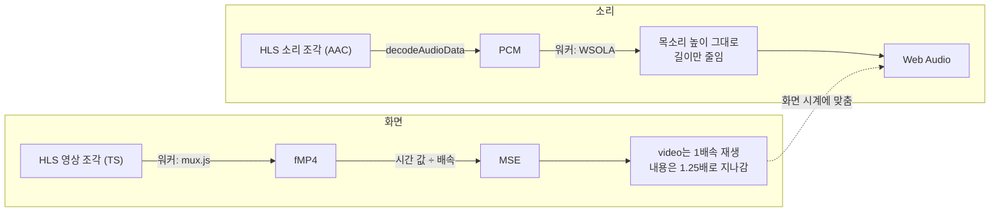

# Class101 for webOS

LG webOS TV용 비공식 클래스101 앱

LG TV에서 [클래스101](https://class101.net) 강의를 리모컨으로 편하게 보기 위한 **비공식** webOS 앱입니다.
클래스101 웹사이트를 TV에 띄우는 대신, 앱이 TV용 화면을 직접 그리고 강의 목록과 영상만 클래스101에서 받아 옵니다.

> **비공식 프로젝트입니다.** 클래스101(CLASS101)과 관계가 없고, 클래스101이 만들거나 확인하지 않았습니다.
> 내가 결제한 강의를 내 TV에서 보기 위한 개인 시청용이며, 영상을 내려받거나 저장하는 기능은 없습니다.
> 클래스101의 비공개 API를 쓰기 때문에 언제든 동작하지 않을 수 있습니다. 클래스101 이용약관 안에서 쓰세요.

*English: an unofficial LG webOS TV app for watching your own CLASS101 classes with the remote. It talks to
CLASS101's web backend directly, and plays lectures at 0.75–2x with pitch-kept sound, which LG's app media
stack can't do by itself. Korean UI only.*

## 화면



| 강의 목록 | 1.25배 재생 (자막, 진행 막대) |
| --- | --- |
|  |  |
| **빠른 메뉴 (▲)** | **클래스 찾기** |
|  |  |

<sub>스크린샷 속 클래스·크리에이터·표지·계정은 모두 지어낸 예시입니다. `npm run screenshots`로 다시 만들 수 있어요.</sub>

## 할 수 있는 것

- **로그인**: 이메일·비밀번호는 TV에서 바로. 카카오·네이버·구글·애플·페이스북 계정은 컴퓨터에서 한 번 로그인해 TV로 넘깁니다(아래 참고).
- **내 클래스**: 이어보기(최근 강의)와 수강 중인 클래스
- **클래스 찾기**: 검색(PLUS 포함 클래스), 카테고리, 인기 검색어
- **강의 목록**: 챕터별 커리큘럼, 완료(✓)·잠김(🔒) 표시
- **재생**: 보던 위치부터 이어보기, 위치와 시청 기록 자동 저장(클래스101 웹·앱과 공유: 이어보기, 진도율, 강의 완료), 끝나면 다음 강의 자동 재생, 자막(한·영·일)
- **배속 재생**: 0.75~2배, 소리 포함, 목소리 높이 그대로

## 지원 TV

webOS 4(2018년형) 이상을 목표로 빌드합니다. 확인한 TV는 LG OLED55CX(2020년형, webOS 5.6.2, 크롬 68 엔진)입니다.
LG 콘텐츠 스토어 앱이 아니므로 TV의 **개발자 모드**로 설치합니다.

## 설치

필요한 것: TV와 같은 네트워크의 컴퓨터, [Node.js](https://nodejs.org) 22 이상, (카카오·네이버·구글·애플·페이스북 로그인용) 크롬·엣지·브레이브 중 하나.

### 1. TV를 개발자 모드로

1. [LG 개발자 사이트](https://webostv.developer.lge.com)에 가입합니다(무료).
2. TV의 LG 콘텐츠 스토어에서 **Developer Mode** 앱을 설치하고, 개발자 계정으로 로그인한 뒤 **Dev Mode Status**를 켭니다(TV 재부팅).
3. Developer Mode 앱을 다시 열고 **Key Server**를 켭니다. 화면에 TV IP와 6자리 Passphrase가 나옵니다.

### 2. 컴퓨터에서 설치

```sh
git clone https://github.com/sapsaldog/class101-for-webos.git && cd class101-for-webos
npm install
npm run tv:setup -- 192.168.0.XX   # TV 화면에 나온 IP
npm run tv:key                     # TV 화면의 Passphrase 입력
npm run tv:info                    # 연결 확인
npm run deploy                     # 빌드 → .ipk → 설치 → 실행
```

TV 홈 화면에 **클래스101** 앱이 생깁니다.

## 로그인

| 가입 방법 | 로그인 |
| --- | --- |
| 이메일 | TV 로그인 화면에서 이메일·비밀번호 입력 |
| 카카오·네이버·구글·애플·페이스북 | 컴퓨터에서 `npm run tv:login` |



`npm run tv:login`은 새 크롬 창(임시 프로필)으로 클래스101 로그인 페이지를 엽니다. 거기서 평소처럼 로그인하면 창이 저절로 닫히고, TV 앱이 다시 실행되면서 로그인됩니다. 클래스101 사이트에서 직접 로그인하므로 클래스101이 지원하는 모든 방법이 됩니다.

- 로그인 정보(갱신 토큰)는 화면에 찍거나 파일로 저장하지 않고 개발자 모드 연결로만 TV에 보냅니다. 임시 브라우저 프로필은 바로 지웁니다.
- 크롬 계열 브라우저가 없거나 자동화된 창이 싫다면 `npm run tv:login -- --manual`: 평소 브라우저에서 class101.net에 로그인한 뒤, 안내되는 한 줄을 그 탭의 개발자 도구 콘솔에서 실행하고 결과를 터미널에 붙여넣습니다.
- 다른 브라우저를 쓰려면 `CHROME_PATH=/경로/브라우저 npm run tv:login`.

TV 앱에서 로그아웃했거나 로그인이 만료되면 같은 방법으로 다시 넘기면 됩니다.

## 리모컨

강의 영상

| 버튼 | 동작 |
| --- | --- |
| OK | 재생 / 일시정지 |
| ◀ ▶ | 10초 뒤로 / 앞으로 (길게 누르면 30초씩) |
| ▲ | 빠른 메뉴: 재생 속도, 자막, 다음·이전 강의, 처음부터, 강의 목록 |
| ▼ | 진행 상태 보기 |
| CH ▲ / CH ▼ | 다음 강의 / 이전 강의 |
| 뒤로 | 강의 목록으로 (보던 위치 저장) |
| 빨강 / 초록 | 속도 느리게 / 빠르게 (마지막 속도 기억) |
| 숫자 1~9, 0 | 10~90% 위치로, 0은 처음으로 |

목록 화면: 방향키로 이동, OK로 선택, 뒤로는 이전 화면(첫 화면에서 두 번 누르면 종료), 파랑은 도움말.
최신 매직리모컨에는 색상 버튼이 없지만, 색상 버튼 기능은 모두 영상 중 ▲ 메뉴에 있습니다.

## 배속 재생은 어떻게 하나

LG TV 앱 환경에서는 기본 플레이어를 1배속이 아닌 속도로 돌리면 소리가 꺼지고 화면이 뚝뚝 넘어갑니다. 웹 표준 방식(MSE)으로 넣은 영상은 `playbackRate`를 아예 무시합니다. 그래서 1배속이 아니면 앱이 직접 재생합니다.

- **화면**: HLS 영상 조각을 직접 받아 TS를 fMP4로 바꾸고(mux.js), 조각 안의 시간 값을 배속만큼 줄여 MSE에 넣습니다. TV는 1배속으로 재생한다고 믿지만, 줄어든 시간축 때문에 1.25배로 지나갑니다.
- **소리**: 강의의 별도 소리 트랙을 받아 WSOLA로 목소리 높이를 유지한 채 길이만 줄이고, Web Audio로 화면 시계에 맞춰 틉니다.
- 무거운 계산은 웹 워커에서 돌려 리모컨 반응과 화면이 끊기지 않게 합니다.



자세한 설계와 TV에서 잰 숫자는 [AGENTS.md](AGENTS.md)에 있습니다.

## 개발자 모드 유지 (중요)

LG 개발자 모드는 **1000시간(약 41일)** 짜리 세션입니다. 만료되면 TV가 개발자 모드를 끄고 **이 앱을 지웁니다**.
한 달에 한 번쯤 `npm run extend`를 실행하거나 TV의 Developer Mode 앱에서 EXTEND를 누르세요.
지워졌다면 Developer Mode를 다시 켜고 `npm run tv:key` → `npm run deploy`를 하면 됩니다.

## 구조

```
app/                 appinfo.json(1280x720, 뒤로 버튼 직접 처리), index.html, 아이콘
src/app/
  main.jsx, App.jsx  화면 스택(로그인 → 내 클래스 → 강의 목록 → 재생)과 리모컨 키 분배, 컴퓨터에서 넘긴 로그인 받기
  auth.js            이메일·비밀번호 로그인(Firebase Auth REST), 넘겨받은 토큰 사용, 토큰 자동 갱신
  api.js             클래스101 GraphQL: 내 클래스, 이어보기, 검색, 카테고리, 커리큘럼, 영상 주소, 진도 저장, 시청 기록
                     (시청 시간은 클래스101 REST API로)
  screens/*.jsx      Login, Home, Search, Klass, Player
  speedVideo.js      배속 화면(MSE, 줄인 시간축)
  speedAudio.js      배속 소리(Web Audio, 화면 시계에 맞춤)
  wsola.js, fmp4.js  목소리 높이 유지 시간 늘이기, fMP4 시간축 줄이기
  media.worker.js    TS→fMP4 변환과 WSOLA를 웹 워커에서
  focus.js, overlay.js, captions.js, luna.js, polyfills.js
service/             TV 안에서 도는 Node.js 서비스: GraphQL 요청을 Accept-Language: ko로 대신 보냄
                     (TV 웹 엔진이 언어 헤더를 TV 메뉴 언어로 덮어써서, 그대로 두면 제목이 영어로 옴)
                     시청 시간도 여기서 보냄 (클래스101 API가 TV 앱에서 바로 온 요청을 CORS로 막음)
scripts/             build.mjs, worker.mjs, tv.mjs(LG CLI 래퍼), tv-login.mjs(로그인 넘기기), make-icons.mjs
test/                가짜 클래스101 서버와 옛 크롬(68)으로 돌리는 화면·배속·로그인 테스트
```

## 개발

```sh
npm run build          # dist/ (릴리스, 압축)
npm test               # 단위 테스트 + 개발 빌드 + e2e·배속·로그인 테스트
npm run screenshots    # README 스크린샷 다시 만들기 (지어낸 예시 데이터, 구글 크롬·ffmpeg 필요)
sh test/make-media.sh  # 테스트용 영상·소리 만들기 (ffmpeg)
npm run inspect        # TV에서 실행 중인 앱에 Web Inspector 연결
```

앱 아이콘과 시작 화면을 내 것으로 바꾸려면 `app/local/`에 `icon.png`(80×80), `largeIcon.png`(130×130), `splash.png`(1920×1080) 중 원하는 것을 넣고 다시 빌드하세요. 이 폴더는 저장소에 올라가지 않습니다.

테스트에는 크롬 68(webOS 5와 같은 엔진)과 구글 크롬(H.264/AAC 재생용)이 필요합니다. 크롬 68은 구글 스냅숏 빌드를 받아 씁니다(macOS).

```sh
mkdir -p ~/.cache/class101-for-webos/chromium-68 && cd ~/.cache/class101-for-webos/chromium-68
curl -fL -o chrome-mac.zip "https://www.googleapis.com/download/storage/v1/b/chromium-browser-snapshots/o/Mac%2F561733%2Fchrome-mac.zip?alt=media"
unzip -q chrome-mac.zip && rm chrome-mac.zip
```

## 한계와 주의

- 클래스101이 서버 API를 바꾸면 고쳐야 합니다(`src/app/api.js`).
- 2026-11 기준 강의 영상은 DRM 없는 HLS(서명된 CloudFront 주소)입니다. 클래스101이 DRM을 도입하면 이 방식으로는 재생할 수 없습니다.
- 배속 중 화질은 720p(1.5배를 넘으면 540p)입니다. 확인한 TV는 1080p를 배속 속도로 처리하지 못했습니다.
- 확인한 TV는 초당 30장까지만 보여 줘서, 1.25배에서는 다섯 장에 한 장꼴로 건너뜁니다.

## 라이선스

[MIT](LICENSE)
